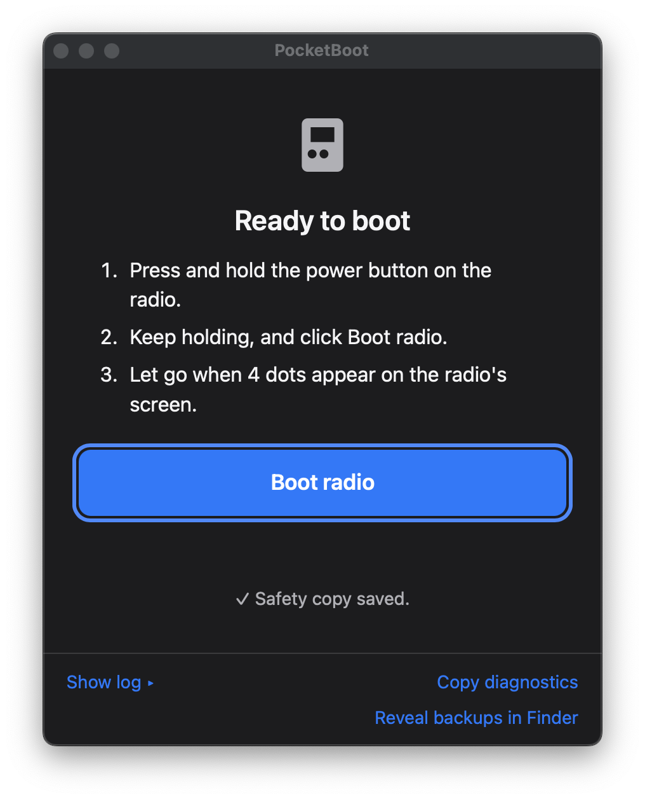
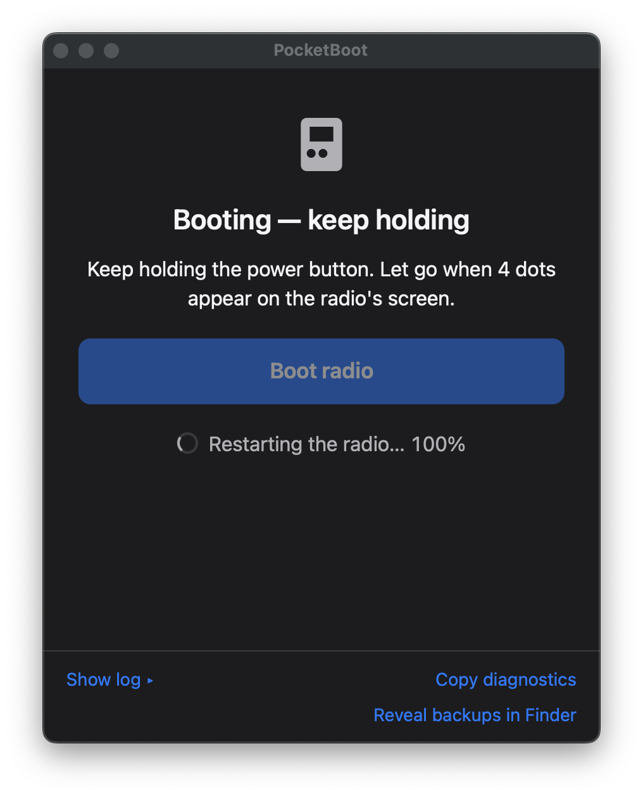
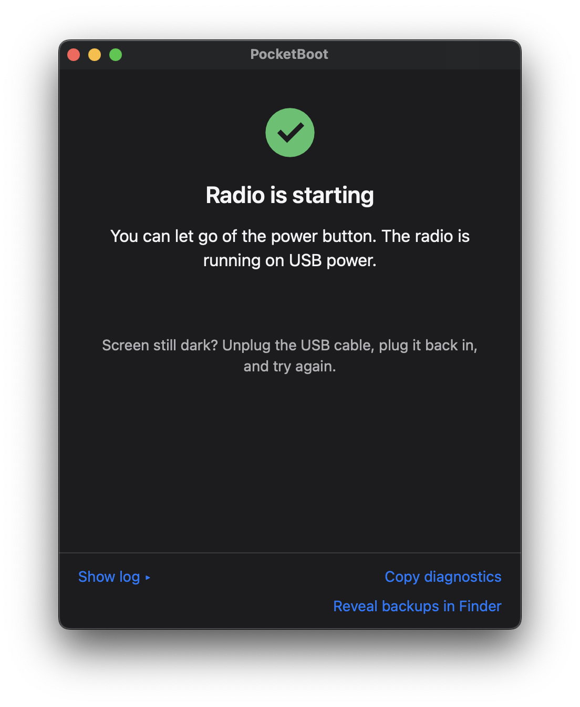

# PocketBoot

PocketBoot starts a RadioMaster Pocket from USB power when you want to use it
without a battery. Connect the radio to your Mac, then follow the instructions
in the app.

## Download and install

1. Open this repository’s [Releases](../../releases/latest) page.
2. Download the file named `PocketBoot-v…-macOS-universal.dmg`.
3. Open the downloaded disk image and drag **PocketBoot** into **Applications**.
4. Open PocketBoot from Applications.

PocketBoot requires macOS 11 or later, a RadioMaster Pocket, and a USB cable
that supports data.

## Start the radio

1. Turn the radio off.
2. Connect the cable to your Mac and to the USB port on top of the radio.
3. Wait for PocketBoot to find the radio and save its safety copy. The app will
   show **Ready to boot** when it is ready.
4. Press and hold the radio’s power button.
5. While continuing to hold the button, click **Boot radio** in the app.
6. Keep holding until four dots appear on the radio screen, then let go.

If the radio screen stays dark, unplug the USB cable, plug it back in, and try
again. If PocketBoot does not find the radio, check that the radio is off and
try a different data-capable USB cable.

### What the app looks like

**Ready to boot:** PocketBoot has found the radio and saved its safety copy.



**Booting:** Keep holding the radio’s power button until four dots appear.



**Success:** The radio is starting and you can let go of the power button.



## For maintainers: publish a release

Releases are built and published manually from GitHub Actions. First, push the
changes you want to release to the branch you plan to release from. Then open
**Actions → Publish macOS release → Run workflow**, enter a stable version such
as `0.1.1`, choose the branch to release, and start the workflow. GitHub only
offers the manual workflow after its file has been pushed to the repository’s
default branch.

The workflow updates the app’s version files, builds and signs a universal macOS
app, notarizes it with Apple, commits the version update, creates the matching
`v…` Git tag, and publishes a DMG and SHA-256 checksum to GitHub Releases. The
version commit and tag are pushed to the selected branch. Use a new version for
each release.

### One-time GitHub setup

Add these repository Actions secrets under **Settings → Secrets and variables →
Actions**:

- `APPLE_CERTIFICATE_P12_BASE64`: base64-encoded Developer ID Application `.p12` file.
- `APPLE_CERTIFICATE_PASSWORD`: password used when exporting that `.p12` file.
- `APPLE_ID`: Apple ID email used for notarization.
- `APPLE_IDENTITY`: full Developer ID Application signing identity, for example
  `Developer ID Application: Your Name (TEAMID)`.
- `APPLE_ID_PASSWORD`: Apple app-specific password used for notarization.
- `APPLE_TEAM_ID`: Apple Developer team ID.

The Apple certificate must be a **Developer ID Application** certificate. The
Apple ID must have access to the Developer account, and its app-specific
password is used for notarization. GitHub Actions also needs permission to write
repository contents so it can push the version commit and tag and publish the
release. Branch protection must allow this workflow to push to the selected
branch.

On a Mac, export the Developer ID certificate from Keychain Access as a `.p12`
file, then copy its base64 text into the `APPLE_CERTIFICATE_P12_BASE64` secret:

```sh
base64 -i DeveloperID.p12 | tr -d '\n' | pbcopy
```

Set `APPLE_IDENTITY` to the exact identity name shown by
`security find-identity -v -p codesigning`. Create an app-specific password
for `APPLE_ID_PASSWORD` in your Apple account settings.

## For contributors

The app uses a Tauri desktop shell with a Rust core and a TypeScript interface.
The `dfu-util` sidecar is built from the pinned source and checksum:

```sh
pnpm install
scripts/build-dfu-util.sh
pnpm tauri dev
```

See [the fixture notes](src-tauri/tests/fixtures/README.md) for the status of
real radio transcripts and parser coverage.

## Licenses

PocketBoot includes dfu-util (GPL-2.0-or-later) and statically links libusb
(LGPL-2.1). License texts and source links are available from **Licenses…** in
the app menu.
