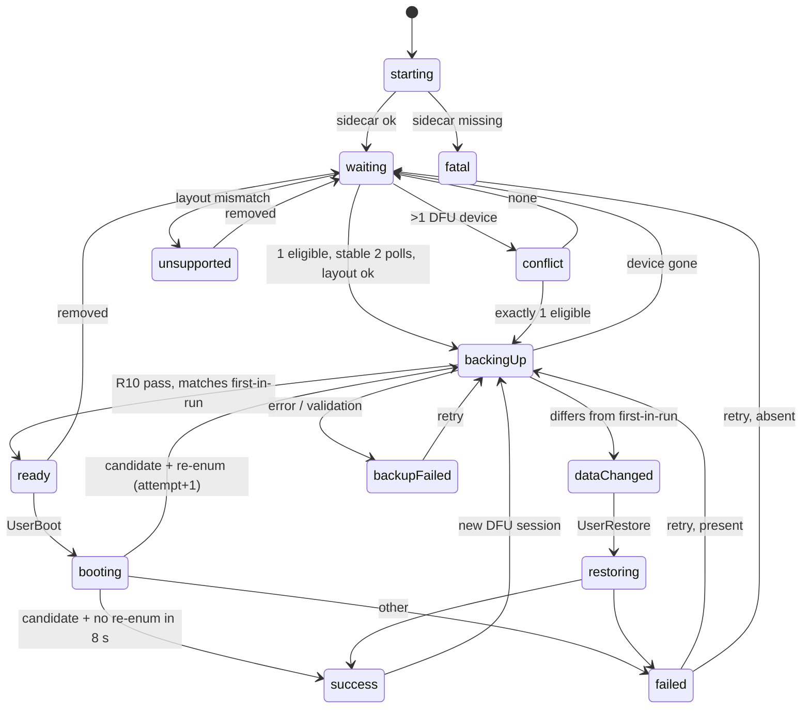
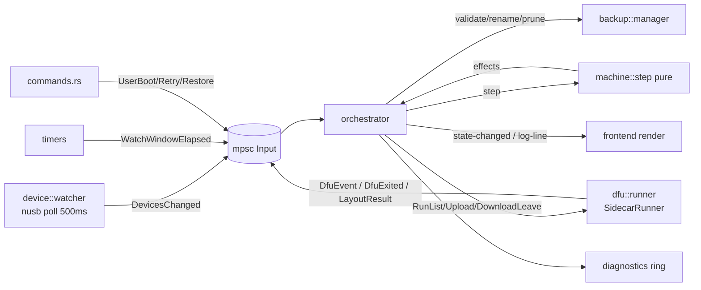

## Goal Capsule

**Objective.** Ship a single-window macOS app, PocketBoot, that boots a battery-less RadioMaster Pocket on USB power. The app replaces two manual `dfu-util` commands with one button. A user who has never opened Terminal should succeed on the first try.

**Means.** A Tauri v2 app whose Rust core drives a bundled, pinned dfu-util sidecar through a pure state machine (KTD1, KTD3).

**Execution profile.** Greenfield repo, Deep plan, 10 units (U1–U10). Rust core is test-first; frontend and packaging are smoke-verified.

**Who finishes.** `ce-work` implements U1–U10 autonomously. A human with a real Pocket, a Developer ID, and notarization credentials finishes the Manual hardware checklist, the Q5 fixture capture, and release signing (see Definition of Done).

**Stop conditions for the executor.**
- Stop if any unit would need a Tauri command that accepts a path, address, length, VID/PID, or data (R15).
- Stop if a code path could emit a flash write without a backup that passed R10 in the current session (R3). The one sanctioned exception is Restore earlier copy from `dataChanged` (R14): it writes this run's first-in-run backup only after `BackupManager::revalidate` re-checks R10(b)–(e) on it.
- Stop if the dfu-util sidecar cannot be built or stubbed so `tauri-build` succeeds (U2 fallback exhausted).

**Product authority.** This document is the product contract. Implementation planning may choose libraries and file layout. It may not change the following without revising this contract:
- the state machine
- the user-facing copy
- the safety rules (R10–R21)
- the trigger interaction (R6)

**Open blockers.** None block planning or implementation. Three hardware facts are open. Until a human with a Pocket captures them (Definition of Done), the executor builds on the stated defaults A1–A3, and each default has a fallback:
- Q1: does the bootloader expose a USB serial number?
- Q2: how does the radio behave after a missed leave?
- Q5: what are the exact dfu-util transcripts?

Each has a stated fallback, so none blocks the build.

---

## Product Contract

### Summary

PocketBoot detects a RadioMaster Pocket in STM32 DFU mode, saves a validated copy of flash sector 0, and writes those same bytes back with a DFU leave when the user clicks Boot radio. Every safety rule lives in Rust, and the frontend only renders state.

### Problem Frame

A battery-less Pocket can only be started from USB by a timed `dfu-util` read-and-write-back. Today that takes Terminal, Homebrew, and two commands typed while holding the power button.

### Requirements

The R-IDs are grouped by concern in the subsections below. This index only says where each group lives:
- R1–R4: Success criteria (Overview)
- R5–R9, R30–R32: UX flow and copy
- R10–R21: Safety rules
- R22: Architecture, state schema
- R23–R27: dfu-util integration
- R40–R46: macOS packaging
- R50–R54: Polish

Product Contract preservation note: the Summary, Problem Frame, and this index were added during planning. They are navigation only. Every R-ID, the state table, the copy, and the Error mapping table are unchanged from the brainstorm contract.

### Overview

The RadioMaster Pocket (STM32F4 MCU, EdgeTX) will not power on from USB alone. The known workaround has four steps:

1. Plug the powered-off radio into its top USB port. The STM32 ROM bootloader then enumerates as a DFU device (`0483:df11`).
2. Read flash sector 0 (16 KB at `0x08000000`) to a file.
3. Write those same bytes back with dfu-util's `:leave` modifier. The real DFU leave/reset jumps into EdgeTX.
4. Hold the radio's power button during the reset until 4 dots appear. The firmware then latches power.

PocketBoot wraps steps 2 and 3 in a guarded, automatic flow.

The device is hard to damage:
- The STM32 system bootloader lives in ROM. A bad sector-0 write cannot remove DFU mode, so any outcome can be fixed by re-entering DFU.
- The app protects the user's working firmware anyway. It never writes bytes other than ones it read from the same device. It also keeps timestamped backups.

**Flash wear.** Each boot erases and rewrites sector 0. STM32F4 flash is rated for about 10,000 erase cycles, which is about 27 years of one boot per day. This is acceptable for v1. Q4 tracks a possible zero-write alternative.

**Who it is for.** Pocket owners using the radio as a USB-powered transmitter, for example as a Meshtastic/ELRS bench rig or with batteries removed for storage. These users can install a Mac app but may never have used Terminal.

**Success criteria**

- R1. A first-time user goes from launch to a booted radio using only the on-screen text, with no Terminal or Homebrew.
- R2. A missed timing attempt can be retried without unplugging the cable, whenever the radio returns to DFU on its own (see R8).
- R3. No code path writes flash without a validated backup from the same device in the same DFU session (R10–R14).
- R4. Every dfu-util failure maps to a plain-language state with one clear next action (see the Error mapping table).

---

### UX flow and copy

#### Interaction model

The app has one screen. Its content is driven by a single state value pushed from Rust (see Architecture). The user never selects a device, a file, or an address. Detection and backup start automatically. The only deliberate user action in the normal flow is **Boot radio**.

#### Trigger timing (R5–R6)

- R5. The trigger is a **plain click** on **Boot radio**. Return and Space also activate it when it has focus. The instruction is ordered: hold the power button first, keep holding, then click.
- R6. Why a plain click:
  - Holding the power button early does no harm. Holding late is the only way the boot fails.
  - A click lets the user start holding first and act when ready, so the app never races the user's hand.
  - A countdown was rejected. It makes the app set the pace, so a user who is still finding the button fails, and it adds seconds of holding for nothing.
  - Hold-to-confirm was rejected. It needs two hands holding at once (radio button plus mouse), which is awkward on a trackpad, and a premature release cancels the boot.
  - The click is the action the user expects. It needs no tutorial.

#### State machine

States, in rough order:

| State | Enters when | Leaves when |
|---|---|---|
| `starting` | App launch | Sidecar self-check passes → `waiting`; fails → `fatal` |
| `waiting` | No eligible DFU device | One eligible device stable for 2 polls → `backingUp` |
| `conflict` | More than one DFU-class device present | Exactly one eligible device remains → `backingUp`; none → `waiting` |
| `unsupported` | One `0483:df11` device whose memory layout is not 16 KB at sector 0 (R16) | Device removed → `waiting` |
| `backingUp` | Eligible device detected (new DFU session) | Valid backup → `ready`; device vanished → `waiting`; error → `backupFailed`; mismatch with this run's earlier backup → `dataChanged` |
| `ready` | Backup valid | Click Boot → `booting`; device removed → `waiting` |
| `booting` | Boot clicked | See success/failure rules (R8) |
| `success` | Leave completed and the device stays off the DFU bus for 8 s | New DFU session → `backingUp` |
| `failed` | Write or leave failed before completion | Try again → `backingUp` (if the device is present) or `waiting` |
| `backupFailed` | Read failed or failed validation | Try again → `backingUp`; device removed → `waiting` |
| `dataChanged` | Fresh read differs from this run's earlier backup for the same serial (R14) | Restore → `restoring`; device removed → `waiting` |
| `restoring` | User chose Restore earlier copy | Same exit rules as `booting` |
| `fatal` | Bundled dfu-util missing or will not run | No exit; quit only |

- R7. `detected` is not a separate visible state. Detection goes straight to `backingUp`, whose copy says the radio was found. This avoids a screen that flashes by in under a second.
- R8. How `booting` ends, decided after dfu-util exits:
  - **Success candidate:** the output reached `Download done.` (100%) and either reached `Submitting leave request` or ended with a benign post-leave error (see the Error mapping table). Start an 8-second watch window.
    - The same serial re-enumerates in DFU within the window → this is a missed catch. Go to `backingUp` with `attempt += 1`, and use the retry copy in `ready`.
    - The device does not reappear → `success`.
  - **Failure:** any other outcome → `failed`.
- R9. The `ready` state shows retry copy when `attempt > 1`. Retrying works without unplugging because a missed catch makes the radio fall back into DFU. If it does not fall back (Q2), the `success` copy covers the dark-screen case with an unplug-and-replug instruction.

#### Copy per state

Copy is final unless marked *(placeholder)*. Steps render as a numbered list. **Bold** marks the primary button.

**`starting`**
- Headline: `Starting…`
- Body: none (usually shown for less than 200 ms)

**`waiting`**
- Headline: `Connect your radio`
- Body:
  1. `Turn the radio off.`
  2. `Take the batteries out.`
  3. `Plug the USB cable into the port on the top of the radio.`
- Status line: `Looking for the radio…` (with a spinner, or static text under reduced motion)
- No button

**`backingUp`**
- Headline: `Radio found`
- Body: `Saving a safety copy of the radio's startup data. This takes a few seconds.`
- Status line: `Saving… {percent}%`
- No button

**`ready`** (attempt 1)
- Headline: `Ready to boot`
- Body:
  1. `Press and hold the power button on the radio.`
  2. `Keep holding, and click Boot radio.`
  3. `Let go when 4 dots appear on the radio's screen.`
- Primary: **`Boot radio`**
- Footnote: `Safety copy saved.`

**`ready`** (attempt > 1)
- Headline: `Let's try that again`
- Body: `The radio restarted before the power button was held. This time, hold the power button first.`
  1. `Press and hold the power button on the radio.`
  2. `Keep holding, and click Boot radio.`
  3. `Let go when 4 dots appear.`
- Primary: **`Boot radio`**

**`booting`**
- Headline: `Booting — keep holding`
- Body: `Keep holding the power button. Let go when 4 dots appear on the radio's screen.`
- Status line: `Restarting the radio… {percent}%`
- Button disabled

**`success`**
- Headline: `Radio is starting`
- Body: `You can let go of the power button. The radio is running on USB power.`
- Secondary text: `Screen still dark? Unplug the USB cable, plug it back in, and try again.`
- No button. The app returns to `backingUp` on its own the next time the radio enters boot mode.

**`failed`**
- Headline: `That didn't work`
- Body: `{reason}`, taken from the Error mapping table
- Primary: **`Try again`**
- Secondary: `Show log`

**`backupFailed`**
- Headline: `Couldn't save the safety copy`
- Body: `{reason}`. Then: `Nothing was changed on the radio.`
- Primary: **`Try again`**

**`conflict`**
- Headline: `More than one device is connected`
- Body: `PocketBoot found {n} devices in update mode:` followed by a list of `{product} ({vid}:{pid}, serial {serial})`. Then: `Unplug the ones you're not using. PocketBoot will continue on its own.`
- No button

**`unsupported`**
- Headline: `This doesn't look like a RadioMaster Pocket`
- Body: `The connected device ({product}, serial {serial}) has a different memory layout. PocketBoot only works with the RadioMaster Pocket, so it won't touch this device.`
- No button

**`dataChanged`**
- Headline: `The radio's startup data changed`
- Body: `The safety copy from {time} doesn't match what's on the radio now. This can happen if the cable was unplugged during a boot. PocketBoot won't write anything until you choose.`
- Primary: **`Restore earlier copy`**
- Secondary: `Reveal backups in Finder`
- Footnote *(placeholder)*: `If you just updated EdgeTX, unplug the radio and quit PocketBoot. The next launch starts fresh.`

**`restoring`**
- Same layout and copy as `booting`, with headline `Restoring — keep holding`

**`fatal`**
- Headline: `PocketBoot is damaged`
- Body: `A required part of the app is missing or blocked. Download PocketBoot again and replace this copy.`
- Secondary: `Copy diagnostics`

Always visible, below the content:
- `Show log ▸` disclosure
- `Copy diagnostics`
- `Reveal backups in Finder`

#### Interaction rules

- R30. Focus moves to the primary button whenever a state with a primary button is entered.
- R31. The `Boot radio` button is debounced. A second activation while `booting` is ignored.
- R32. Closing the window during `booting` or `restoring` asks first: `The radio is restarting. Quit anyway?` with the options `Wait` (default) and `Quit`. dfu-util keeps running until it exits, and the app quits after that.

---

### Wireframe

The main window is 440 × 560 pt, resizable with that as the minimum, centered on first launch.

```
┌──────────────────────────────────────────────┐
│ ● ● ●              PocketBoot                │
├──────────────────────────────────────────────┤
│                                              │
│                 [ radio icon ]               │
│                                              │
│               Ready to boot                  │  ← headline (title2)
│                                              │
│   1  Press and hold the power button         │
│      on the radio.                           │  ← numbered steps
│   2  Keep holding, and click Boot radio.     │
│   3  Let go when 4 dots appear on the        │
│      radio's screen.                         │
│                                              │
│      ┌──────────────────────────────────┐    │
│      │           Boot radio             │    │  ← primary, 52pt tall,
│      └──────────────────────────────────┘    │    full width minus margins
│                                              │
│            ✓ Safety copy saved.              │  ← footnote / status line
│                                              │
├──────────────────────────────────────────────┤
│ Show log ▸         Copy diagnostics          │
│                    Reveal backups in Finder  │  ← footer utilities
└──────────────────────────────────────────────┘

With "Show log ▾" expanded, the window grows by 180 pt:
├──────────────────────────────────────────────┤
│ ┌──────────────────────────────────────────┐ │
│ │ $ dfu-util -d 0483:df11 -S 3276… -a 0 …  │ │  ← monospace, read-only,
│ │ Opening DFU capable USB device...        │ │    selectable, autoscroll
│ │ Upload  [=========================] 100% │ │
│ │ Upload done.                             │ │
│ └──────────────────────────────────────────┘ │
└──────────────────────────────────────────────┘
```

---

### Safety rules

All rules are enforced in Rust. The frontend cannot bypass any of them, because no command accepts a path, address, VID/PID, or byte payload (R15).

**Backup validity before any write**

- R10. A write is only allowed when a backup from the **current DFU session** meets all of these:
  - (a) dfu-util exited 0 and printed `Upload done.`
  - (b) the file is exactly 16384 bytes
  - (c) the bytes are not all `0xFF`
  - (d) the bytes are not all `0x00`
  - (e) the SHA-256 recorded at read time still matches the file when re-hashed immediately before the write (protects against the file changing in between)
- R11. A DFU session is one continuous presence of a serial on the bus. A disappearance ends the session, and any re-enumeration triggers a fresh backup before `ready`. A backup from an earlier session is never used for a normal boot.
- R12. The write source is always the exact file produced by R10, written to `0x08000000` only, through `-s 0x08000000:leave`. The address is a compile-time constant.

**Device binding**

- R13. Every dfu-util invocation includes `-d 0483:df11 -S <serial> -a 0`. The serial is the one the watcher saw. If the bootloader exposes no serial (Q1), the app runs only when exactly one DFU-class device is present, and it re-checks that immediately before each invocation.
- R14. **Within one app run**, the fresh read for a serial is compared with the first valid backup of that serial taken in the same run. A mismatch blocks writing and moves to `dataChanged`. **Restore earlier copy** writes that earlier backup, which is still bytes read from the same device, and only after the backup passes R10(b)–(e). Backups from earlier app runs are never written automatically. The comparison runs **before** the R10(c)/(d) blank checks. If an earlier backup of this serial exists in this run, a blank read goes to `dataChanged` (an interrupted write erased the sector), not to `backupFailed`.
- R15. No Tauri command accepts a file path, address, length, VID/PID, or data. The frontend can only request: start boot, retry, restore, reveal backups, copy diagnostics, and toggle the sound.
- R16. Only act on `0483:df11`. On detection, run `dfu-util -l -d 0483:df11` (read-only) and parse alt 0's name. It must start with `@Internal Flash` and declare `/0x08000000/` with a first segment of `04*016K` (four 16 KB sectors). Anything else goes to `unsupported`.
- R17. Count every USB device exposing a DFU interface (class `0xFE`, subclass `0x01`, any VID/PID) on each poll. If more than one is present, go to `conflict` and name each one. Never pick one.

**Backup storage**

- R18. Backups live under `<app_data_dir>/backups/<serial>/`. On macOS that is `~/Library/Application Support/com.pocketboot.app/backups/<serial>/`. They are never written to `/tmp`.
  - Filename: `YYYYMMDDTHHMMSSZ-sector0.bin` plus a sidecar `…-sector0.json` holding `{serial, size, sha256, created_at, app_version, dfu_util_version, layout}`.
  - The serial is sanitized to `[A-Za-z0-9_-]`. A missing serial uses `no-serial`.
  - Directories are created with mode 0700 and files with 0600.
- R19. dfu-util writes into a unique `…-sector0.bin.partial` path in the same directory. This avoids dfu-util's create-exclusive failure when a file already exists. After R10 passes, the file is renamed atomically to its final name. Failed partials are deleted.
- R20. Keep the newest 20 backups per serial (Q6) and prune older ones after each successful backup. The first backup ever taken for a serial is never pruned. It is labelled `-first` in its filename and is the known-good original.

**Non-fatal outcomes**

- R21. A device disappearing during `backingUp` is non-fatal. Delete the partial and return to `waiting` without an error screen. "Device already left DFU" during `booting` after `Download done.` counts as a success candidate (R8), not a failure. The legacy "already run" error cannot occur, because every read uses a fresh filename (R19). If it ever appears, it is logged as an internal error.

---

### Architecture

#### Stack

- Tauri v2 with a Rust backend.
- Frontend: vanilla TypeScript plus Vite, with no framework.
  - One `render(state)` function swaps the content per state. There are about 13 states and no client-side logic beyond rendering and four button handlers, so a framework would add build weight with nothing in return.
  - Svelte is an acceptable alternative if the implementer prefers components.

#### Rust modules (`src-tauri/src/`)

| Module | Responsibility |
|---|---|
| `device/watcher.rs` | Polls USB every 500 ms with `nusb` (read-only enumeration; never opens or claims a device). Emits `DeviceSnapshot { dfu_devices: Vec<DfuDeviceInfo> }` on change. `DfuDeviceInfo { vid, pid, serial: Option<String>, product: Option<String>, location_id }`. Applies the 2-poll stability rule. |
| `device/layout.rs` | Runs `dfu-util -l` through the runner and parses the alt-0 name into `FlashLayout { base, segments }` for R16. |
| `dfu/runner.rs` | `trait DfuRunner { fn list(..); fn upload(serial, dest) ; fn download_leave(serial, src) }`. Each call returns a stream of `DfuEvent` and a final `DfuOutcome`. `SidecarRunner` spawns the bundled binary with an argument vector (no shell) and a cleared environment except `PATH=/usr/bin:/bin` and `LANG=C`. `MockRunner` replays fixtures. |
| `dfu/args.rs` | The only place dfu-util arguments are built. Takes only `serial` and a path produced by `BackupManager`. Constants: `VIDPID = "0483:df11"`, `ALT = "0"`, `ADDR = 0x0800_0000`, `LEN = 16384`. |
| `dfu/parser.rs` | Pure function: line → `DfuEvent` (see dfu-util integration). |
| `backup/manager.rs` | Paths, partial→final rename, validation (R10), SHA-256, retention (R20), comparison (R14), reveal in Finder (`open -R`). |
| `machine.rs` | Pure state machine: `fn step(state: &AppState, input: Input) -> (AppState, Vec<Effect>)`. No I/O. All of R7–R21's branching lives here. |
| `orchestrator.rs` | Async task (tokio). Owns the `AppState`. Takes `Input`s from the watcher, runner, timers, and commands through one `mpsc` channel, applies `machine::step`, executes `Effect`s, and emits events. It guarantees **at most one dfu-util process at a time**. |
| `diagnostics.rs` | Ring buffer of the last 500 log lines, plus the diagnostics report builder. |
| `commands.rs` | Tauri command handlers. Each only sends an `Input` to the orchestrator. |

**Inputs** (into `machine::step`):
- `DevicesChanged(DeviceSnapshot)`
- `LayoutResult(Result<FlashLayout>)`
- `DfuEvent(DfuEvent)`
- `DfuExited(DfuOutcome)`
- `WatchWindowElapsed`
- `UserBoot`
- `UserRetry`
- `UserRestore`
- `SidecarCheck(Result<Version>)`

**Effects:**
- `RunList(serial)`
- `RunUpload(serial)`
- `RunDownloadLeave(serial, BackupRef)`
- `StartWatchWindow(8s)`
- `DeletePartial`
- `PlaySuccessSound`
- `Notify`

#### Tauri commands

| Command | Args | Returns |
|---|---|---|
| `get_state` | — | `AppState` |
| `boot` | — | `()`. Ignored unless the state is `ready` |
| `retry` | — | `()`. Valid in `failed` and `backupFailed` |
| `restore_earlier_copy` | — | `()`. Valid in `dataChanged` |
| `reveal_backups` | — | `()`. Opens the backups folder in Finder |
| `get_diagnostics` | — | `String`. The frontend copies it with the clipboard plugin |
| `get_log` | — | `Vec<LogLine>` |
| `set_success_sound` | `enabled: bool` | `()`. Persisted in the app config |

#### Events (Rust → frontend)

| Event | Payload |
|---|---|
| `state-changed` | Full `AppState`, so the frontend never diffs |
| `log-line` | `LogLine { ts, stream: "stdout" \| "stderr" \| "app", text }` |

#### State schema (serialized as JSON, `camelCase`)

```ts
type AppState =
  | { kind: "starting" }
  | { kind: "waiting" }
  | { kind: "conflict"; devices: DeviceLabel[] }
  | { kind: "unsupported"; device: DeviceLabel }
  | { kind: "backingUp"; device: DeviceLabel; percent: number }
  | { kind: "ready"; device: DeviceLabel; attempt: number; backupAt: string }
  | { kind: "booting"; device: DeviceLabel; attempt: number; percent: number }
  | { kind: "restoring"; device: DeviceLabel; percent: number; backupAt: string }
  | { kind: "success"; device: DeviceLabel }
  | { kind: "failed"; device?: DeviceLabel; reason: ReasonCode; message: string; canRetry: boolean }
  | { kind: "backupFailed"; device?: DeviceLabel; reason: ReasonCode; message: string }
  | { kind: "dataChanged"; device: DeviceLabel; earlierBackupAt: string }
  | { kind: "fatal"; reason: ReasonCode; message: string }
  // reserved for Windows, never emitted on macOS:
  | { kind: "driverMissing"; device: DeviceLabel };

type DeviceLabel = { vid: string; pid: string; serial?: string; product?: string };
type ReasonCode =
  | "deviceGone" | "accessDenied" | "busy" | "notWriteable" | "usbIo"
  | "timeout" | "validationSize" | "validationBlank" | "hashMismatch"
  | "sidecarMissing" | "unknown";
```

- R22. `message` is always user-facing copy from the Error mapping table. Raw dfu-util text appears only in the log and in diagnostics.

---

### dfu-util integration

#### Decision: bundled sidecar plus native enumeration

- R23. Transfers use a **bundled dfu-util 0.11 sidecar**, built from source with **libusb 1.0.27 linked statically**, as a universal (arm64 + x86_64) binary. Users never install Homebrew.
- R24. Device presence and conflict detection use **native Rust enumeration (`nusb`)**. It is read-only and never claims the device, so it can poll every 500 ms without spawning processes. It can also see DFU interfaces from any VID, which R17 needs.

Sidecar vs. a native Rust DFU implementation:

| | Bundled dfu-util | Native Rust (rusb/nusb + DfuSe) |
|---|---|---|
| Proven on this exact radio | Yes. This is the workflow the user already runs | No. DfuSe erase, set-address, and leave sequencing must be rewritten and re-verified |
| DfuSe quirks (dfuERROR clear, manifest, leave) | Handled for over a decade | Must be reimplemented. The manifest/leave edge cases are exactly where bugs live |
| Debuggability | Raw log matches what forum guides show | Custom log format |
| Packaging cost | Build, lipo, and sign one extra binary. GPL notice | None |
| Progress and errors | Must be parsed from text (brittle across versions; mitigated by pinning 0.11) | Typed |
| Future zero-write leave (Q4) | Not possible with stock dfu-util | Possible |

The sidecar wins for v1 because correctness on real hardware matters more than parsing elegance, and pinning the version removes most of the parsing risk. The `DfuRunner` trait keeps a native runner possible later. Q4 is the trigger to build one.

#### Licensing

- R25. dfu-util is GPL-2.0-or-later and libusb is LGPL-2.1.
  - Shipping dfu-util as a separate executable invoked as a subprocess is allowed. PocketBoot's own license is unaffected.
  - The app must ship both license texts and a written offer or link to the exact source tarballs used. Show these under the app menu → `Licenses…` and in the bundle's `Resources/licenses/`.
  - Static libusb inside the dfu-util binary is covered by dfu-util's GPL distribution.

#### Exact invocations

| Purpose | Arguments | Timeout |
|---|---|---|
| Self-check (startup) | `-V` | 5 s |
| Layout and serial (on detection) | `-l -d 0483:df11` | 5 s |
| Backup | `-d 0483:df11 -S <serial> -a 0 -s 0x08000000:16384 -U <backups>/<serial>/<ts>-sector0.bin.partial` | 20 s |
| Boot | `-d 0483:df11 -S <serial> -a 0 -s 0x08000000:leave -D <backups>/<serial>/<ts>-sector0.bin` | 30 s |

- R26. A no-output watchdog kills the process after 10 s of silence, in addition to the total timeout above. Either one maps to `timeout`.

#### Output parsing

- stdout and stderr are both read line by line. dfu-util also redraws progress with `\r`, so split on both `\n` and `\r`.
- Every line goes to the log and through `parser.rs`, which emits one of these:
  - `Progress { op: Upload|Download|Erase, percent }` from lines like `Upload\t[=====    ]  45%` / `Download\t[…]  100%` / `Erase …%`
  - `Milestone(UploadDone | DownloadDone | LeaveSubmitted | DeviceOpened)`
  - `Benign(kind)`
  - `Error(ReasonCode, raw)`
  - `Other`
- Final classification uses the exit code (sysexits: `0` ok, `64` usage, `70` software, `74` I/O) **combined with** the milestones seen. The exit code alone does not decide the result, because a benign post-leave error exits non-zero (R8).
- R27. Patterns are matched case-insensitively as substrings, anchored to dfu-util 0.11 wording. Each one has a captured real-hardware fixture (see Test plan). A dfu-util version other than the bundled one is never used.

---

### macOS packaging

- R40. **Minimum macOS 11.0** (Big Sur), the first release with Apple Silicon. Set `bundle.macOS.minimumSystemVersion = "11.0"`. Assumption, see Q3.
- R41. **Universal build.**
  - Build: `tauri build --target universal-apple-darwin`.
  - Place the sidecar at `src-tauri/binaries/dfu-util-universal-apple-darwin` and also as `dfu-util-aarch64-apple-darwin` and `dfu-util-x86_64-apple-darwin`, so single-arch dev builds work.
  - Register it with `bundle.externalBin: ["binaries/dfu-util"]`.
- R42. **Sidecar build script** (`scripts/build-dfu-util.sh`), per arch:
  - Build libusb with `--disable-shared --enable-static`.
  - Build dfu-util against it with `-framework IOKit -framework CoreFoundation -framework Security`.
  - Run `lipo -create` to make the universal binary.
  - Confirm with `otool -L`: only `/usr/lib` and `/System` dylibs.
  - Record the source tarball SHA-256 values in the repo.
- R43. **Signing.**
  - Sign the sidecar before bundling: `codesign --force --options runtime --timestamp --sign "Developer ID Application: …"`. Tauri re-signs bundled binaries when `signingIdentity` is set; keep the explicit pre-sign so dev builds also run under hardened runtime.
  - The app uses hardened runtime and is **not sandboxed**.
  - Notarize with `notarytool` (Tauri's `APPLE_API_KEY` flow) and staple the DMG.
- R44. **Entitlements and USB access.**
  - No USB entitlement is required. `com.apple.security.device.usb` applies only to sandboxed apps.
  - Hardened runtime does not restrict IOKit USB access for a non-sandboxed process. macOS shows no permission prompt for USB devices.
  - Ship an empty entitlements file and never add `disable-library-validation`.
- R45. **Dock behavior.**
  - A regular Dock app with a single window. Closing the window quits the app (subject to R32).
  - No menu bar extra: the task is occasional and focused, so a persistent status item would be clutter.
  - The app menu includes:
    - `About PocketBoot`
    - `Licenses…`
    - `Play Sound on Success` (checkmark)
    - `Reveal Backups in Finder`
    - `Copy Diagnostics`
- R46. **Windows design hooks (not implemented):**
  - The `DfuRunner` trait and sidecar naming already support `dfu-util-x86_64-pc-windows-msvc.exe`.
  - The `driverMissing` state is reserved in the schema for an STM32 bootloader that is visible without a WinUSB driver (the Zadig problem). Its copy and remedy are designed later.
  - All paths come from Tauri's `app_data_dir`, and no code assumes `/` paths or `open -R`. Reveal goes through a `reveal(path)` helper that switches on the platform.

---

### Polish

- R50. **Dark and light mode** follow the system through CSS `prefers-color-scheme`. All colors are defined as CSS custom properties. The primary button uses the system accent (`AccentColor` / `-apple-system-control-accent`) with a fallback.
- R51. **Show log**: a collapsed disclosure showing a monospace, read-only, selectable, autoscrolling view of `log-line` events. Each dfu-util command line appears prefixed with `$`. It is capped at 500 lines.
- R52. **Copy diagnostics** puts plain text on the clipboard and shows a `Copied` confirmation for 2 s. The text contains:
  - app version
  - macOS version and arch
  - dfu-util `-V` output
  - current state
  - the DFU device list (VID:PID, product, serial)
  - the parsed layout
  - backup count and newest SHA-256 for the current serial (not the bytes)
  - the last 200 log lines
  The home directory is replaced with `~`.
- R53. **Success feedback.** When a boot reaches `success`:
  - Play the system "Glass" sound. This is on by default (Q7) because the user is watching the radio, not the screen.
  - If the window is not focused, also post a notification: `Radio is starting`.
  - Both can be turned off.
- R54. **Accessibility.**
  - Headline and body are inside an `aria-live="polite"` region, so state changes are announced. Failures use `assertive`.
  - All actions are real `<button>`s with visible focus rings.
  - Text contrast is at least 4.5:1 in both themes. Text sizes are in `rem`.
  - Spinners become static text under `prefers-reduced-motion`.
  - State is never conveyed by color alone: each state has an icon and a headline.
  - VoiceOver label on the primary button: `Boot radio. Hold the radio's power button first.`

---

### Error mapping table

| dfu-util output (substring, case-insensitive) | Context | Classification | User message (`message`) | Next state |
|---|---|---|---|---|
| `Invalid DFU suffix signature` / `A valid DFU suffix will be required` | any | Benign | — | — |
| `state(10) = dfuERROR` / `firmware is corrupt`, followed by `Clearing status` | first contact | Benign (bootloader quirk, auto-cleared) | — | — |
| `Upload done.` | backup | Milestone `UploadDone` | — | validate → `ready` |
| `Download done.` | boot | Milestone `DownloadDone` | — | — |
| `Submitting leave request` | boot | Milestone `LeaveSubmitted` | — | watch window (R8) |
| `Error during download get_status` / `LIBUSB_ERROR_PIPE` / `LIBUSB_ERROR_NO_DEVICE` / `can't detach` | boot, **after** `DownloadDone` | Benign post-leave | — | watch window (R8) |
| `No DFU capable USB device available` | backup or list | Non-fatal, device gone (R21) | — | `waiting` |
| `No DFU capable USB device available` / `LIBUSB_ERROR_NO_DEVICE` | boot, **before** `DownloadDone` | `deviceGone` | `The radio was unplugged during the boot. Plug it back in. PocketBoot will check its startup data before trying again.` | `failed` (then R14 check on reconnect) |
| `More than one DFU capable USB device found` | any | `conflict` (defensive; R13 should prevent it) | conflict copy | `conflict` |
| `Cannot open DFU device` / `LIBUSB_ERROR_ACCESS` / `LIBUSB_ERROR_BUSY` | any | `busy` | `Another app is using the radio. Quit Betaflight Configurator, STM32CubeProgrammer, or similar apps, then click Try again.` | `failed` / `backupFailed` |
| `Last page at 0x… is not writeable` | any | `notWriteable` | `The radio refused the write. This usually means the device isn't a RadioMaster Pocket. Nothing was changed.` | `failed` (`canRetry: false`) |
| `Cannot set alternate interface` / `Could not find alt` | any | `unsupported` | unsupported copy | `unsupported` |
| `LIBUSB_ERROR_IO` / `LIBUSB_ERROR_TIMEOUT` / `Error during upload` / `Error during download` (before `DownloadDone`) | backup or boot | `usbIo` | `The USB connection dropped out. Try a different cable or port, then click Try again.` | `failed` / `backupFailed` |
| `Cannot open file` / `File exists` | backup | `unknown` (internal; R19 should prevent it) | `Something went wrong inside PocketBoot. Click Try again. If it keeps happening, use Copy diagnostics and report it.` | `backupFailed` |
| *(watchdog or total timeout, R26)* | any | `timeout` | `The radio stopped responding. Unplug it, plug it back in, and PocketBoot will start over.` | `failed` (`canRetry: false`) |
| *(validation: size ≠ 16384)* | backup | `validationSize` | `The safety copy came back incomplete. Nothing was changed on the radio.` | `backupFailed` |
| *(validation: all 0xFF or all 0x00)* | backup | `validationBlank` | `The safety copy is blank, so PocketBoot won't write it back. Nothing was changed on the radio. If this keeps happening, the radio may need EdgeTX reinstalled.` | `backupFailed` |
| *(hash mismatch before write)* | boot | `hashMismatch` | `The safety copy changed on disk. PocketBoot will make a fresh one.` | `backingUp` |
| *(sidecar missing or `-V` fails)* | startup | `sidecarMissing` | fatal copy | `fatal` |
| *(non-zero exit, nothing above matched)* | any | `unknown` | `Something unexpected happened. Click Try again. If it keeps happening, use Copy diagnostics and report it.` | `failed` / `backupFailed` |

---

### Test plan

#### Unit tests (no hardware; `cargo test`)

1. **Parser** (`dfu/parser.rs`):
   - Every row of the Error mapping table has a fixture line and an expected `DfuEvent`.
   - Progress parsing works on `\r`-split lines.
   - Fixtures are full transcripts captured from real hardware (Q5) and checked into `src-tauri/tests/fixtures/`. These are: happy upload, happy download+leave, first-contact dfuERROR, unplug mid-upload, unplug mid-download, busy device.
2. **State machine** (`machine.rs`):
   - A table-driven test of `(state, input) → (state, effects)` for every arrow in the state table.
   - Includes: the 2-poll debounce, conflict entry and exit, a success candidate followed by re-enumeration within 8 s (`attempt` becomes 2), a success candidate with no re-enumeration (`success`), a benign post-leave error before vs. after `DownloadDone`, and a blank read after an interrupted boot (goes to `dataChanged`, not `backupFailed`, per R14).
3. **Safety invariants**:
   - Property tests confirm that `RunDownloadLeave` is never emitted unless the session's backup passed R10.
   - It is never emitted with a backup from another serial or an earlier session (except `UserRestore` from `dataChanged`).
   - It is never emitted while more than one DFU device is present.
4. **Backup manager**:
   - Validation rejects 16383, 16385, all-`0xFF`, and all-`0x00` files, and accepts a random 16384-byte file.
   - Partial→final rename works. Filenames are unique under rapid repeats.
   - Pruning keeps 20 backups plus `-first`.
   - Permissions are 0700/0600. A hash mismatch is detected.
5. **Argument builder**: every invocation contains `-d 0483:df11`, `-S <serial>`, `-a 0`, and the fixed address. No public function takes an address, length, or arbitrary path.
6. **Runner with a mock binary**:
   - A small test binary, `fake-dfu-util`, replays a fixture chosen by an environment variable, including delays, exit codes, and silence.
   - It covers the watchdog, timeouts, and the one-process-at-a-time guarantee through the real `SidecarRunner` spawning code.

#### Manual hardware checklist (real Pocket, signed release build, clean Mac user account)

1. **Happy path.** Fresh install, no Homebrew.
   - Launch, plug the radio in, and confirm `ready` appears within 5 s.
   - Hold power and click Boot. Confirm 4 dots, the radio boots, and `success` plays the sound.
   - Confirm a backup and its `.json` exist in the folder opened by `Reveal backups in Finder`.
2. **Missed timing.**
   - Click Boot without holding power. Confirm the app returns to `ready` with the retry copy without unplugging (or confirm the fallback per Q2).
   - Retry while holding, and confirm the radio boots.
3. **Unplug mid-operation.**
   - (a) Unplug during `backingUp`: the app returns to `waiting` with no error, and no `.partial` remains.
   - (b) Unplug during `booting` before 100%: `failed` appears. On replug, `dataChanged` appears, and **Restore earlier copy** followed by holding power boots the radio.
4. **Wrong device and conflict.**
   - (a) Connect a non-F4 STM32 board in DFU (for example an H7 flight controller): `unsupported`, and nothing is written (check the log for no `-D`).
   - (b) Connect the Pocket plus a second DFU device: `conflict` names both. Unplugging one continues automatically.
   - (c) Connect any non-DFU USB device: no reaction.
5. **Repeated runs and failures.**
   - (a) Boot 10 times in a row with unplug and replug in between. Each run makes a fresh backup, all succeed, and the backup count stays at 20 plus `-first`.
   - (b) Backup failure: with Betaflight Configurator connected to the radio, PocketBoot shows `busy` copy. Quit Betaflight, click Try again, and it succeeds.
   - (c) Gatekeeper: the downloaded DMG opens with no "unidentified developer" prompt, and `spctl -a -vv` on the app and on the sidecar both say accepted.
   - (d) VoiceOver walkthrough of the happy path, and a dark/light mode check.

#### Acceptance

The release passes when:
- all unit tests pass
- every manual item passes on one Apple Silicon Mac and one Intel Mac (or Rosetta-free x86_64 check on Intel hardware)
- the happy path succeeds for a tester who has never seen the app, with no help beyond the window text (R1)

---

### Out of scope for v1

- Flashing EdgeTX firmware or any user-chosen file
- Radios other than the RadioMaster Pocket
- Windows and Linux builds (hooks only; see R46)
- Auto-update of the app
- Restoring backups from earlier app runs (they are kept for manual recovery only)

---

### Future work

- **Zero-write leave.** If Q4's spike shows that `SET_ADDRESS` plus a zero-length `DNLOAD` triggers a leave without erasing, add a native `DfuRunner` that boots with no flash write. This removes flash wear and most of the safety surface, and the backup becomes optional.
- **Windows.** Ship `dfu-util.exe` as a sidecar. Detect the bootloader through SetupAPI when it has no WinUSB driver and show `driverMissing` with guided driver installation (libwdi-based installer, or Zadig instructions).
- **Linux.** Ship a udev rule for `0483:df11` and package as AppImage.
- **Other radios.** Move the constants (VID/PID, layout pattern, sector length, copy strings) into a per-model profile.
- **EdgeTX flashing.** Possible in a later version as a separate, explicit mode. It would need different safety rules (file validation, model match).

---

### Open questions

Each item is an assumption the spec currently relies on. Each has a working default so the build is not blocked.

- Q1. **Bootloader serial.** Assumption: the STM32 ROM bootloader reports a unique USB serial (it usually does, derived from the chip UID). Fallback if it does not: R13's "exactly one DFU device" mode and the `no-serial` backup folder. In that mode R14 compares against the previous backup taken in this run.
- Q2. **Radio behavior after a missed leave.** Assumption: when the user is not holding power, the radio resets, loses power, and does **not** re-enter DFU without a replug. If so, the 8-second retry path (R8/R9) never fires and the `success` secondary copy handles it. If it does re-enter DFU, retry without unplugging works as designed. Also unverified: whether 8 s is the right window. Measure the re-enumeration time and set the window to measured + 3 s.
- Q3. **Minimum macOS 11.** Chosen as the first universal-binary macOS. Check that Tauri v2 and `nusb` work on 11 before release. Raise to 12 if not.
- Q4. **Zero-write leave spike.** Unknown whether the Pocket's bootloader accepts a leave without a preceding write. v1 keeps the write-back. Run a one-hour hardware spike with a scratch native runner.
- Q5. **dfu-util transcripts.** The error strings in the table come from dfu-util 0.11 source and common reports, not from captures on this radio. Capture real transcripts for all fixture scenarios before finalizing the parser.
- Q6. **Retention count.** N = 20 per serial plus the never-pruned first backup. Each backup is 16 KB, so disk use is negligible. The number only limits clutter.
- Q7. **Success sound default.** On by default, because the user's eyes are on the radio. Turn it off by default if testers find it annoying.
- Q8. **Vector-table sanity check.** Not committed. An extra validation could require the first word (initial stack pointer) to look like `0x2000xxxx` and the second (reset vector) to look like `0x0800xxxx`. This would reject a half-written sector that is neither blank nor zero. Recommended for v1 if Q5 confirms EdgeTX's sector 0 always passes. Decide during implementation.
- Q9. **MCU and layout.** Assumption: the Pocket uses an STM32F4 part with 16 KB sector 0 (layout `04*016K…`). R16 enforces this. If any Pocket revision differs, R16 rejects it safely, and the layout check would need a per-revision allow-list.
- Q10. **`dataChanged` after an EdgeTX update.** If a user updates EdgeTX while PocketBoot stays open, the next read legitimately differs and lands in `dataChanged`. The current answer is the placeholder footnote telling them to quit and relaunch. A better option (for example `Use current data` after the Q8 check passes) is deferred.
- Q11. **Bundle identifier and signing team.** `com.pocketboot.app` and the Developer ID team are placeholders.

---

## Planning Contract

### Key Technical Decisions

- **KTD1. Pure state machine plus a single-owner orchestrator.** `machine::step(&AppState, Input) -> (AppState, Vec<Effect>)` holds no I/O. One tokio task owns the state and drains a single `mpsc::Receiver<Input>`. Every safety rule (R10–R21) can then be table-tested and property-tested without hardware. The one-process-at-a-time guarantee falls out of the orchestrator never starting an effect while a `DfuRun` is in flight. Governs R3, R7–R21, R22.
- **KTD2. The machine carries session facts, not the orchestrator.** `Session { serial, layout_ok, backup: Option<ValidatedBackup>, first_in_run: Option<BackupRef>, attempt }` lives inside `AppState`'s private context. `RunDownloadLeave` can only be built from a `ValidatedBackup`, a type whose constructor is private to `backup::manager`. Only two functions can produce one: `validate` (fresh upload) and `revalidate(BackupRef)`. `revalidate` is the Restore path. It re-reads the first-in-run file and re-checks R10(b)–(e), and a failure becomes an Input that leads to `failed`. So the type system enforces "no write without an R10-checked image", and proptest is the second line of defence for "current session or sanctioned Restore". Governs R3, R10, R11, R14.
- **KTD3. dfu-util as a sidecar spawned through `std::process::Command` from Rust, not the shell plugin's JS API.** The resolved path is `std::env::current_exe()?.parent()/dfu-util`, which is where Tauri places `externalBin` in `Contents/MacOS/`. A dev override comes from `POCKETBOOT_DFU_UTIL`, compiled only under `cfg(debug_assertions)` or tests. The frontend gets no shell capability at all. Governs R15, R23, R26.
- **KTD4. `nusb` 0.2 for read-only enumeration.** Use `nusb::list_devices().wait()` (trait `MaybeFuture`) on a 500 ms `tokio::time::interval` inside `spawn_blocking`. DFU detection checks `DeviceInfo::interfaces()` for class `0xFE`/subclass `0x01`, so R17 sees every VID. Serial comes from `serial_number()`, and `location_id()` breaks ties when there is no serial. Governs R13, R17, R24.
- **KTD5. Versions pinned to the current stable set** (checked 2026-10):
  - Rust: tauri 2.12, tauri-build 2.7, tauri-plugin-clipboard-manager 2.5, tauri-plugin-notification 2.7, tauri-plugin-dialog 2 (R32 close prompt, called from Rust), nusb 0.2.8, sha2 0.11, tokio 1.54 (`rt-multi-thread, macros, time, sync, process, io-util`), serde 1, serde_json 1, thiserror 2, time 0.3 (formatting), proptest 1.12 (dev).
  - JS: @tauri-apps/cli 2.12, @tauri-apps/api 2.12, @tauri-apps/plugin-clipboard-manager 2.5, vite 8, typescript 7.
- **KTD6. Vanilla TS frontend with a copy table keyed by `kind`.** `src/copy.ts` holds the exact strings from "Copy per state". `src/render.ts` maps `AppState` to DOM. `src/main.ts` wires events and commands. Svelte is not used. Governs R5, R30, R31, R50, R51, R54.
- **KTD7. Error mapping lives in one place.** `dfu/parser.rs` classifies lines. `machine.rs` combines milestones with exit codes. The table's user strings live in `src-tauri/src/messages.rs`, and the frontend never formats a reason. Governs R4, R22, R27.
- **KTD8. Sidecar build is a script, not a build.rs step.** `scripts/build-dfu-util.sh` downloads pinned tarballs, verifies them against `scripts/dfu-util.sha256`, builds both arches, and runs `lipo`. Running it is a manual or CI pre-step. For dev and unit tests, the `binaries/` placeholder may be a stub script so `tauri-build` resolves `externalBin`. Governs R41, R42.
- **KTD9. Q8 vector-table check is included as a soft rule.** The first word must lie in `0x2000_0000..0x2003_0000` (or CCM `0x1000_0000..0x1001_0000`), and the second word's top byte must be `0x08`. It runs after the blank checks and maps to `validationBlank`. Q8 makes the check conditional on Q5 confirmation, and the fixtures are synthetic, so it ships behind `VECTOR_CHECK: bool = false`. It is implemented and tested, but stays disabled. A human enables it after real Q5 captures confirm the vector ranges (Definition of Done).
- **KTD10. R13 serial/address pinning applies to transfer invocations.** `upload` and `download_leave` always carry `-d 0483:df11 -S <serial> -a 0 -s 0x08000000…`. `version()` (`-V`) and `list()` (`-l`) are fixed argv vectors that need no serial and never touch flash.
- **KTD11. Shared core types live in `types.rs`.** `ReasonCode` and `Serial` sit in `src-tauri/src/types.rs` so that `dfu`, `backup`, and `machine` can share them without a dependency cycle. `PartialPath` and `ValidatedBackup` stay in `backup` to keep KTD2's private constructor.
- **KTD12. U5 extends the Architecture Inputs.** Beyond the Architecture list, the machine accepts `BackupValidated(..)` (KTD2) and `RestoreValidated(Result<ValidatedBackup, ReasonCode>)`. These are implementation plumbing for existing arrows and add no new states.
- **KTD13. A second DFU device during a session.** Any snapshot with more than one DFU device moves the machine to `conflict` (R17), whether it arrives in `waiting`, `backingUp`, `ready`, or `dataChanged`. An in-flight upload is allowed to finish, and its result is discarded. `booting` and `restoring` are not interrupted by a snapshot (a write in flight is only ever ended by its own exit or the R26 watchdog). Their outcome is decided first, then the next snapshot applies.

### High-Level Technical Design

State flow (the authoritative arrows are in the Product Contract state table):



Data flow:



### Assumptions

These are agent bets that no human has confirmed. Downstream review should check them.

- A1. Q1 default: the ROM bootloader exposes a serial. The no-serial fallback is still implemented (R13), and backups for it go to `no-serial/`.
- A2. Q2 default: the 8 s watch window stays as the constant `WATCH_WINDOW = 8s` until hardware measurement.
- A3. Q5: parser fixtures are synthetic transcripts, written from dfu-util 0.11 source wording and marked `synthetic` in `src-tauri/tests/fixtures/README.md`. Replacing them with real captures is a human Definition-of-Done item. A1–A3 are the executor's working defaults. They supersede the "confirm first" wording in the Goal Capsule and Test plan item 1 until the human captures land.
- A4. Bundle id `com.pocketboot.app` and a placeholder signing identity (Q11). Signing config is read from env (`APPLE_SIGNING_IDENTITY`), so unsigned local builds work.
- A5. The app version starts at `0.1.0`.
- A6. The success sound plays through `NSSound` via `/usr/bin/afplay /System/Library/Sounds/Glass.aiff`, spawned from Rust. This avoids an Objective-C bridge crate. The setting persists in `<app_config_dir>/settings.json`.
- A7. The R32 close confirmation uses Tauri's `on_window_event(CloseRequested)` plus `tauri-plugin-dialog` for the native `Wait`/`Quit` prompt.
- A8. The repo is initialised with `git init` during U1 because the folder is not yet a repository.

### Risks

- dfu-util wording on real hardware may differ from the synthetic fixtures. Mitigation: substring matching (R27), an `unknown` fallback, and the human fixture-capture DoD item.
- A universal sidecar build needs both toolchains plus network access. Mitigation: the KTD8 stub keeps dev and tests green, and the release pipeline runs the script.
- macOS 11 support for Tauri 2.12 is unconfirmed (Q3). Mitigation: a manual check before release.

### Sequencing

U1 → U2 → U4 → U3 → U5 → U7 → U6 → U8 → U9 → U10.
- U1 creates `types.rs` (KTD11).
- U3 needs U4's `PartialPath` and `ValidatedBackup`.
- U5 needs U3's `DfuEvent` and `DfuOutcome`.
- U6 needs the U7 runner for its layout probe.

---

## Output Structure

```
.
├── package.json, pnpm-lock.yaml, tsconfig.json, vite.config.ts, index.html
├── src/                     # frontend
│   ├── main.ts  render.ts  copy.ts  types.ts  styles.css
├── scripts/
│   ├── build-dfu-util.sh    dfu-util.sha256
├── src-tauri/
│   ├── Cargo.toml  build.rs  tauri.conf.json  Entitlements.plist
│   ├── capabilities/default.json
│   ├── binaries/            # dfu-util-{universal,aarch64,x86_64}-apple-darwin (stub in dev)
│   ├── licenses/            # dfu-util COPYING, libusb COPYING, SOURCES.md
│   ├── src/
│   │   ├── main.rs  lib.rs  types.rs  machine.rs  orchestrator.rs  commands.rs
│   │   ├── diagnostics.rs  messages.rs  settings.rs  menu.rs
│   │   ├── device/{mod,watcher,layout}.rs
│   │   ├── dfu/{mod,args,parser,runner}.rs
│   │   ├── backup/{mod,manager}.rs
│   │   └── bin/fake-dfu-util.rs
│   └── tests/
│       ├── fixtures/*.txt  fixtures/README.md
│       └── runner_fake.rs
```

---

## Implementation Units

### U1. Scaffold the Tauri v2 project and repository

- **Goal:** a `pnpm tauri dev`-capable skeleton with no shell capability exposed to the frontend.
- **Requirements:** R15, R40, R45 (single window), A8.
- **Files:** `package.json`, `tsconfig.json`, `vite.config.ts`, `index.html`, `src/main.ts`, `src-tauri/{Cargo.toml,build.rs,tauri.conf.json,capabilities/default.json,src/main.rs,src/lib.rs,src/types.rs}`, `.gitignore`.
- **Approach:**
  - Run `git init`.
  - `Cargo.toml` sets `default-run = "pocketboot"`, because `bin/fake-dfu-util.rs` is a second bin target.
  - `types.rs` holds `ReasonCode` and `Serial` (KTD11).
  - Window: 440×560, min 440×560, centered.
  - `bundle.macOS.minimumSystemVersion = "11.0"`, `identifier = "com.pocketboot.app"`, `externalBin: ["binaries/dfu-util"]`.
  - Capabilities: `core:default`, `core:event:default`, `clipboard-manager:allow-write-text`, `notification:default`. No shell or fs permissions. The dialog plugin is registered for Rust-side use only, so the frontend gets no dialog permission.
- **Test scenarios:** `cargo check` passes and `pnpm build` emits `dist/`.
- **Verification:** `cargo check` in `src-tauri`; `pnpm build`.

### U2. Sidecar build script, stub, and licenses

- **Goal:** a reproducible universal dfu-util, plus a stub that keeps builds green without it.
- **Requirements:** R23, R25, R41, R42.
- **Files:** `scripts/build-dfu-util.sh`, `scripts/dfu-util.sha256`, `src-tauri/binaries/` (stub, git-ignored real binaries), `src-tauri/licenses/{dfu-util-COPYING.txt,libusb-COPYING.txt,SOURCES.md}`.
- **Approach:**
  - Use `set -euo pipefail`. Pin tarball URLs for dfu-util 0.11 and libusb 1.0.27 and verify their SHA-256.
  - Build each arch with `-arch` and `MACOSX_DEPLOYMENT_TARGET=11.0`, run `lipo -create`, check with `otool -L`, and copy to the three target-triple names.
  - A `--stub` flag writes a shell stub that answers `-V` with `dfu-util 0.11 (stub)` and exits 1 otherwise.
- **Test scenarios:** `bash -n` passes, and `--stub` produces executable files at the three names.
- **Verification:** `scripts/build-dfu-util.sh --stub && cargo check`.

### U3. dfu-util argument builder and output parser

- **Goal:** every argv comes from one module, and every output line classifies deterministically.
- **Requirements:** R12, R13, R16, R22, R26, R27, the Error mapping table, Test plan 1 and 5.
- **Files:** `src-tauri/src/dfu/{mod,args,parser}.rs`, `src-tauri/tests/fixtures/*.txt`, `fixtures/README.md`.
- **Approach:**
  - `args.rs` exposes `version()`, `list()`, `upload(&Serial, &PartialPath)`, and `download_leave(&Serial, &ValidatedBackup)`. `PartialPath` and `ValidatedBackup` are newtypes from `backup`, so no function accepts an arbitrary path.
  - `parser.rs` has `split_lines` (on `\r` and `\n`) and `classify(line, Ctx { op, download_done }) -> DfuEvent`, using case-insensitive substrings.
  - `parse_layout(alt0_name) -> Result<FlashLayout>` checks the `@Internal Flash  /0x08000000/04*016Kg,...` form.
  - `final_outcome(exit_code, milestones)` combines the exit code with the milestones seen (R8).
- **Execution note:** test-first.
- **Test scenarios:**
  - one test per Error mapping row
  - progress parsing on `\r` splits
  - each of the 6 transcript fixtures
  - layout accept and reject cases (H7 layout, a `128K` first segment)
  - transfer argv (`upload`, `download_leave`) always contains `-d 0483:df11 -S <s> -a 0` and the fixed address; `version()`/`list()` are fixed vectors (KTD10)
- **Verification:** `cargo test dfu::`.

### U4. Backup manager

- **Goal:** safe paths, validation, hashing, retention, and comparison.
- **Requirements:** R10, R14, R18, R19, R20, KTD2, KTD9.
- **Files:** `src-tauri/src/backup/{mod,manager}.rs`.
- **Approach:**
  - `BackupManager::new(root)`, `new_partial(serial) -> PartialPath`, `validate(partial, upload_done) -> Result<ValidatedBackup, ReasonCode>`, `finalize(...)` (rename, write JSON sidecar, prune), `recheck(&ValidatedBackup)` (re-hash before write), `revalidate(BackupRef) -> Result<ValidatedBackup, ReasonCode>` (Restore path: re-read the first-in-run file and re-check R10(b)–(e); KTD2), `reveal_dir()`.
  - `sanitize_serial`, filenames as `UTC YYYYMMDDTHHMMSSZ` plus a monotonic suffix on collision, and the `-first` label.
  - Directories 0700, files 0600 via `std::os::unix::fs::PermissionsExt`.
  - Blank and vector checks follow the R14 ordering: the comparison is exposed separately so the machine can decide.
- **Execution note:** test-first.
- **Test scenarios:**
  - rejects 16383, 16385, all-FF, and all-00; accepts a valid random image
  - with the vector check enabled (test-only override of `VECTOR_CHECK`), rejects a bad vector table; with the shipped default it is skipped
  - `revalidate` accepts an intact first-in-run file and rejects a truncated or blanked one
  - unique names under rapid repeats
  - prune keeps 20 plus `-first`
  - permissions are 0700/0600
  - recheck detects tampering
  - partials are deleted on failure
- **Verification:** `cargo test backup::`.

### U5. State machine

- **Goal:** all branching for R7–R21 in a pure function.
- **Requirements:** R3, R7–R14, R16, R17, R21, R22, R31, Test plan 2 and 3.
- **Files:** `src-tauri/src/machine.rs`, `src-tauri/src/messages.rs`.
- **Approach:**
  - Implement `AppState` (serde `tag = "kind"`, `rename_all = "camelCase"`), `Input`, and `Effect` as in the Architecture section.
  - Internal `Ctx`: stable-poll counter, session, first-in-run map `serial -> BackupRef`, in-flight op, and download_done flag.
  - The upload result arrives as an `Input::BackupValidated(Result<ValidatedBackup, ReasonCode>, compare: CompareResult)` produced by the orchestrator after the manager runs.
  - `UserBoot` outside `ready` is a no-op, which gives the debounce (R31).
  - `UserRestore` emits `RevalidateFirstInRun(BackupRef)`. `RestoreValidated(Ok)` → `RunDownloadLeave`; `Err` → `failed` (KTD2, KTD12).
  - Mid-session second DFU device follows KTD13.
- **Execution note:** test-first.
- **Test scenarios:**
  - every arrow in the state table
  - 2-poll debounce
  - conflict entry and exit
  - re-enumeration within the window gives attempt 2
  - no re-enumeration gives success
  - a benign error before vs. after `DownloadDone`
  - a blank read after an interrupted boot gives `dataChanged`
  - a second DFU device appearing in `backingUp`, `ready`, or `dataChanged` gives `conflict`; an upload finishing after that is discarded
  - `RestoreValidated(Err)` gives `failed` and emits no write
  - a proptest over random input sequences that `RunDownloadLeave` is only emitted with the current session's validated backup (or the first-in-run backup after `UserRestore` in `dataChanged`), never while more than one DFU device is present, and never during an in-flight op
- **Verification:** `cargo test machine::`.

### U6. Device watcher and layout probe

- **Goal:** feed `DevicesChanged` snapshots, and run layout on detection.
- **Requirements:** R13, R16, R17, R24.
- **Files:** `src-tauri/src/device/{mod,watcher,layout}.rs`.
- **Approach:**
  - `snapshot_from(iter of DeviceInfo)` is pure and filters to DFU-interface devices.
  - `watch(tx)` polls every 500 ms in `spawn_blocking` and sends only on change.
  - `layout.rs` wraps `runner.list()` and `parser::parse_layout`, selecting the line for the right serial.
- **Test scenarios:** the pure snapshot filter, using a fake `DfuDeviceInfo` list (DFU class from another VID counted, non-DFU ignored); layout selection by serial.
- **Verification:** `cargo test device::`.

### U7. Sidecar runner and fake dfu-util

- **Goal:** spawn without a shell, a cleared env, streamed events, a watchdog, and timeouts.
- **Requirements:** R13, R26, KTD3, Test plan 6.
- **Files:** `src-tauri/src/dfu/runner.rs`, `src-tauri/src/bin/fake-dfu-util.rs`, `src-tauri/tests/runner_fake.rs`.
- **Approach:**
  - `tokio::process::Command` with `env_clear()`, `PATH=/usr/bin:/bin`, and `LANG=C`.
  - Read stdout and stderr through a byte reader that splits on `\r`/`\n`.
  - Send `(stream, text)` log lines and `DfuEvent`s to the orchestrator.
  - Run `tokio::select!` over the total timeout, a 10 s idle timeout, and `wait`; kill on timeout.
  - `fake-dfu-util` replays `FAKE_DFU_SCRIPT` lines like `out|text`, `err|text`, `sleep|ms`, and `exit|code`.
- **Test scenarios:** happy upload replay, idle watchdog kills at 10 s (scaled via a test-only constructor), total timeout, and a non-zero exit with milestones.
- **Verification:** `cargo test --test runner_fake`.

### U8. Orchestrator, commands, diagnostics, and events

- **Goal:** wire everything behind path-free commands.
- **Requirements:** R15, R22, R32, R51, R52, R53, A6, A7.
- **Files:** `src-tauri/src/{orchestrator,commands,diagnostics,settings,lib}.rs`.
- **Approach:**
  - One task owns the machine and executes effects: spawn runner jobs, manager validate/finalize, timers, sound, and a notification if the window is unfocused.
  - Emit `state-changed` and `log-line`.
  - Commands send `Input` only. `get_diagnostics` builds the report with `~` substitution.
  - Close handling: while `booting`/`restoring`, prevent close and show a dialog. On `Quit`, set a flag so the app exits after `DfuExited`.
- **Test scenarios:**
  - the diagnostics builder redacts the home dir and caps at 200 lines
  - the ring buffer caps at 500
  - the settings round-trip
  - an orchestrator integration test with `MockRunner` drives `waiting → backingUp → ready → booting → success`
  - a Restore integration test: `dataChanged → UserRestore → revalidate → restoring`, and a tampered first-in-run file goes to `failed` with no download spawned
- **Verification:** `cargo test`, and `cargo clippy -- -D warnings`.

### U9. Frontend

- **Goal:** render every state with the exact copy, plus footer utilities and accessibility.
- **Requirements:** R5, R6, R9, R30, R31, R50, R51, R52, R54, Copy per state.
- **Files:** `src/{main,render,copy,types,styles}.ts|css`, `index.html`.
- **Approach:**
  - `render(state)` builds the DOM from `copy.ts`.
  - Live regions: polite, or assertive for `failed`/`backupFailed`/`fatal`.
  - In `failed`, the Try again primary renders only when `canRetry` is true. Otherwise there is no primary button, and focus goes to the headline.
  - Focus moves to the primary button on entry (or the headline when there is none). The button is disabled until the next `state-changed` after a click.
  - Log disclosure with autoscroll, capped at 500.
  - The Copied toast shows for 2 s.
  - CSS custom properties for light and dark, `AccentColor`, `rem` sizes, and reduced motion.
- **Test scenarios:** `tsc --noEmit` typechecks the `AppState` union exhaustively (`never` check); `vite build` succeeds.
- **Verification:** `pnpm build`.

### U10. Packaging, menu, and licenses

- **Goal:** a releasable bundle configuration.
- **Requirements:** R25, R40–R46.
- **Files:** `src-tauri/src/menu.rs`, `src-tauri/Entitlements.plist`, `tauri.conf.json` bundle section, `README.md`.
- **Approach:**
  - App menu: About, Licenses… (opens the bundled `licenses/` folder via `open`), Play Sound on Success (check item synced with settings), Reveal Backups in Finder, and Copy Diagnostics.
  - `bundle.resources` includes `licenses/`.
  - Empty entitlements, hardened runtime, and `signingIdentity` from env.
  - The README documents the build, sign, and notarize steps.
- **Test scenarios:** `cargo check` with the menu, and a `tauri.conf.json` schema check via `pnpm tauri build --no-bundle` (or `cargo build`) when the CLI is available.
- **Verification:** `pnpm tauri build --debug --no-bundle`, where available.

---

## Verification Contract

| Check | Command | Expectation |
|---|---|---|
| Rust unit and integration tests | `cd src-tauri && cargo test` | all pass, including proptest |
| Lint | `cd src-tauri && cargo clippy --all-targets -- -D warnings` | clean |
| Format | `cargo fmt --check` | clean |
| Frontend typecheck and build | `pnpm build` (runs `tsc --noEmit && vite build`) | clean |
| App compile | `pnpm tauri build --debug --no-bundle` | builds with the stub sidecar |
| Manual hardware | the Product Contract's Manual hardware checklist 1–5 | human-run, needs a Pocket |

---

## Definition of Done

- [ ] U1–U10 are implemented, and every row of the Verification Contract that can be automated passes.
- [ ] No Tauri command accepts a path, address, length, VID/PID, or data (R15). Confirmed by reviewing `commands.rs`.
- [ ] The proptest safety invariants pass.
- [ ] Synthetic fixtures are labelled as such, and a README marks real capture (Q5) as pending.
- [ ] (Human) After real Q5 captures confirm the vector ranges, set `VECTOR_CHECK = true` (KTD9).
- [ ] No stray artifacts: no real dfu-util binaries or build dirs committed, `.gitignore` covers `target/`, `dist/`, `node_modules/`, and `src-tauri/binaries/dfu-util-*` (except the stub generator).
- [ ] **Human-only (deferred):** the real sidecar build, Developer ID signing and notarization, Q1/Q2/Q5 hardware captures, the Manual hardware checklist, and the R1 first-time-user test.
